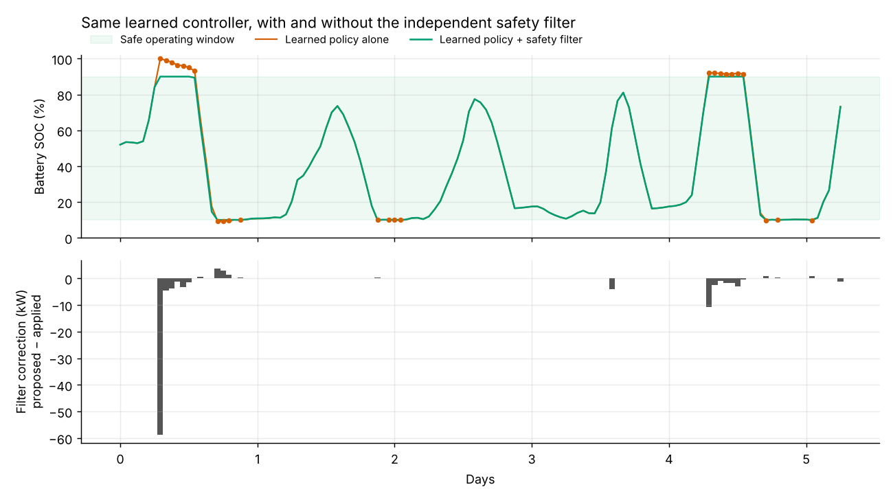
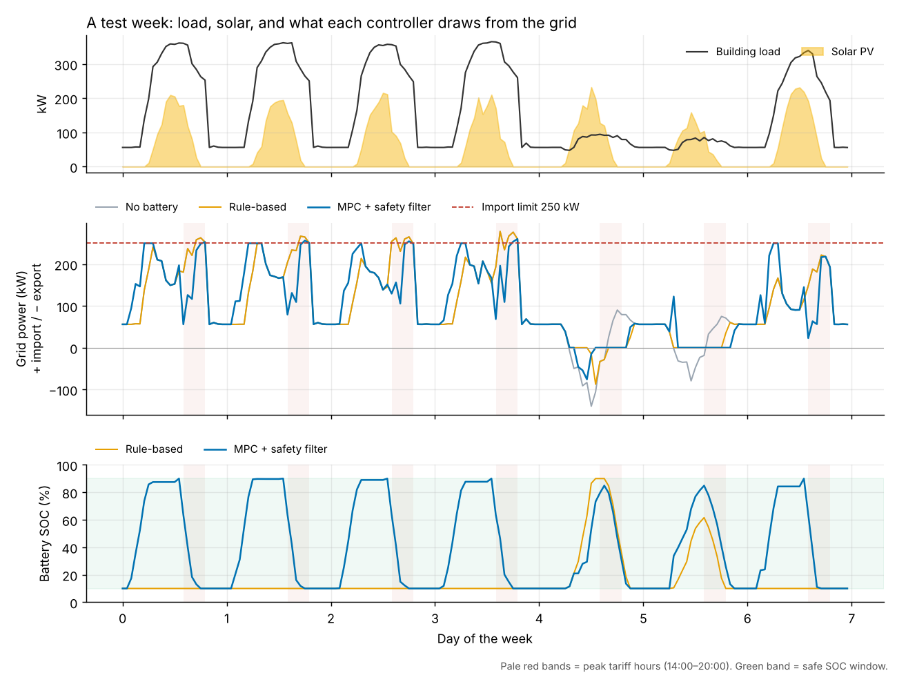
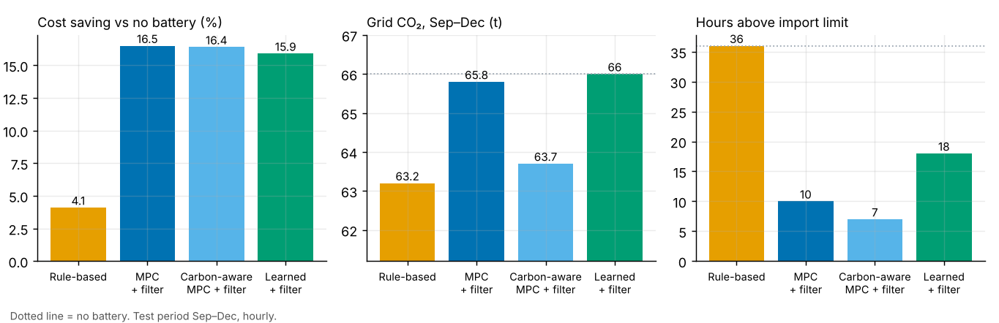

# Safe learning-based control of a solar + battery microgrid

A learned controller can be fast and close to optimal while knowing nothing about the operating limits. In this project I put an independent safety filter between the controller and the battery. The filter only knows the limits, and it keeps the learned controller safe for a very small cost.

The idea comes from my work on wellhead control panels. There, the process PLC runs the plant and a separate safety PLC enforces the limits (IEC 61511). I wanted to see how the same split works when the controller is learned and the plant is an energy system.



## The system

| Part | Value |
|---|---|
| Building load | Primary school, Houston (DOE reference building, hourly, 1 year) |
| Solar PV | 300 kWp, from hourly irradiance (TMY, Houston) |
| Battery | 500 kWh, 125 kW, 95% one-way efficiency |
| Safe operating window | State of charge 10 to 90% |
| Grid | Import limit 250 kW (contract), time-of-use tariff 0.08 / 0.15 / 0.30 $/kWh with the peak from 14:00 to 20:00, export 0.04 $/kWh |
| Battery wear | 0.02 $ per kWh of throughput |
| Train / test | January to August / September to December (2,928 test hours) |

## Controllers compared

1. No battery, as the reference.
2. Rule-based: charge from surplus solar and discharge when the building needs power, as many installed systems do.
3. MPC (model predictive control): every hour it solves a 24-hour linear program over cost, battery wear and limits, then applies only the first hour. I ran it with perfect forecasts as a benchmark, and with realistic forecasts whose error grows with lead time (PV ±30% and load ±10% at 24 h).
4. Carbon-aware MPC: the same MPC with a carbon price of $0.10/kg CO₂ on grid imports.
5. Learned policy: a small neural network (2 × 64) trained to imitate MPC from current measurements. It needs no optimiser at run time, and it has no built-in idea of the limits.

## The safety filter

`src/safety.py` is about 30 lines. Every hour it takes the proposed battery power and the measured state, and changes the power as little as possible so that:

1. the state of charge is still between 10 and 90% after the hour, and
2. grid import stays at or below 250 kW when that is physically possible. If a full safe discharge still cannot hold the import limit, the SOC limit wins and the filter reports the overload.

The filter does not know which controller is running. A property test (`tests/test_safety_filter.py`) feeds it 100,000 random states with deliberately wild proposals, and it allows 0 SOC breaches and 0 avoidable grid-limit breaches.

## Results (test period, September to December)

| Controller | Cost saving vs no battery | Grid CO₂ (t) | Hours outside SOC window | Hours above import limit |
|---|---:|---:|---:|---:|
| No battery | 0% | 66.0 | 0 | 36 |
| Rule-based | 4.1% | 63.2 | 0 | 36 |
| MPC, perfect forecast (benchmark) | 16.6% | 65.7 | 0 | 0 |
| MPC, realistic forecast + filter | 16.5% | 65.8 | 0 | 10 |
| Carbon-aware MPC, realistic forecast + filter | 16.4% | 63.7 | 0 | 7 |
| Learned policy, no filter | 16.1% | 66.1 | 661 | 86 |
| Learned policy + filter | 15.9% | 66.0 | 0 | 18 |

The full table, with peak import, battery cycles and filter interventions, is in `results/results_test_period.csv`.




## What I learned

1. With realistic forecasts, MPC saves 16.5%, four times the rule-based saving of 4.1%. It is also the only controller that holds the grid limit almost all the time. The rule empties the battery in the morning and has nothing left for the afternoon peak.
2. The learned policy costs almost the same as MPC, but on its own it left the safe window in 661 of 2,928 hours (23%), with SOC anywhere from 6.4% to 100%, and broke the grid limit in 86 hours.
3. With the filter in place, the learned policy had 0 SOC breaches, and the cost went up by $82 over four months (+0.2%). Most corrections were small, 3.9 kW on average.
4. The filter cannot plan ahead. The filtered learned policy was still above the grid limit for 18 hours, because the battery was already empty when the peak arrived. MPC, which plans 24 hours ahead, had 10 such hours. So a safety layer and a planning controller do different jobs, and this system needs both.
5. The cheapest schedule was not the cleanest. Cost-optimal MPC charges from the grid at night to avoid peak prices, so it emitted 2.6 t more CO₂ than the simple rule. A carbon price of $0.10/kg cut 2.1 t (3.2%) and added $25 (0.07%) to the bill.

## Limitations

- Simulation only, one building, one year, hourly steps.
- The battery model is simple: no temperature effects, and ageing only as a throughput cost.
- Forecast errors are synthetic. They do not come from a real forecasting model.
- The CO₂ intensity profile is California's (CAISO), while load and PV are Houston's, so the CO₂ numbers show the trend for this setup rather than a real site.
- I trained the learned policy with one random seed. Breach counts will change with retraining; the filter's guarantee will not.

## Next steps

- Train the policy with reinforcement learning instead of imitation, still behind the filter.
- Replace the filter's one-step check with a multi-step one, such as a control barrier function or a short MPC safety check, so it can also avoid the "battery already empty" cases.
- Use real forecasts and data from a real site.

## Run it

```bash
pip install -r requirements.txt
python tests/test_safety_filter.py      # property test of the safety filter
python src/make_figures.py              # runs every controller and saves results + figures (~40 s)
```

## Files

```
src/microgrid.py        system model, data loading, tariff
src/safety.py           independent safety filter
src/controllers.py      rule-based, MPC (cvxpy + HiGHS), learned policy (scikit-learn)
src/run_experiment.py   train, test, metrics table
src/make_figures.py     figures
tests/                  property test of the safety filter
results/                table, traces, figures
```

## Data and credits

The hourly load, irradiance and CO₂ profiles are the ones shipped with [pymgrid](https://github.com/Total-RD/pymgrid) (U.S. DOE commercial reference buildings, TMY weather data, CAISO grid emissions). The tariff and system sizes are my own illustrative choices.

Ghulam Hasnain · [Portfolio](https://sites.google.com/view/ghulam-hasnain/home)
